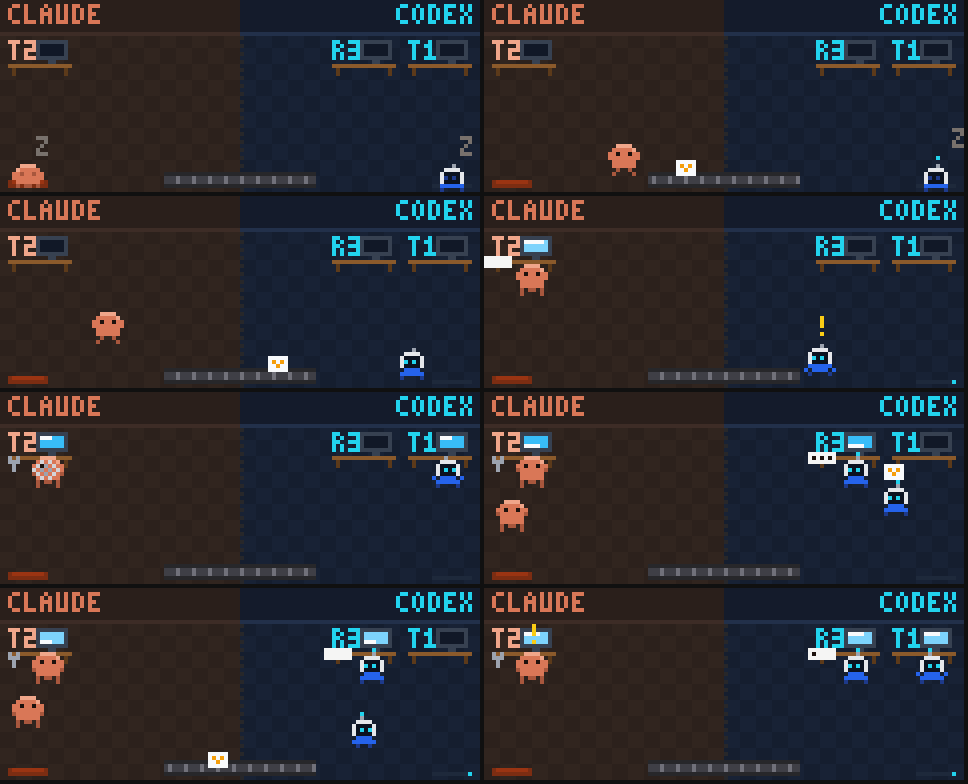

# tandem-split

A live view of a Codex + Claude Code tandem, inside Claude Code. It is the companion mod to the
[codex-claude-tandem](https://github.com/mkhaytman87/codex-claude-tandem) skill: the skill has the two models split a
job in a `TANDEM.md`, and this mod draws that split as it happens.



Two panes:

- **Tandem** (`/tandem`): Claude's lane and Codex's lane side by side, each listing the parts it leads and seconds;
  the tandem's six steps (Decompose → Assign → Confirm → Hand off → Work → Re-assign); and a wire between the lanes.
  - The Claude lane follows the main Claude loop's response as it streams: thinking, text, and the tool being called.
    Subagents and headless `claude -p` runs it started show as running or finished (not their output).
  - The Codex lane follows Codex sessions working in the tandem's folder (see [What it reads](#what-it-reads)): the
    part and role each was handed, each message as it finishes, the command or file it is on, and when it ends.
  - The wire animates what it observes: a packet slides Claude → Codex when a Codex session picks up a part, and
    Codex → Claude when that session writes a file or finishes. It is a picture of activity; it moves nothing.
  - New parts and status changes in `TANDEM.md` flash as they arrive.
- **Tandem Arcade** (`/tandem arcade`, or the **Arcade** button): the same state as a pixel-art office. Claude and
  Codex walk to the desk of the part they are on, type, think, and nap when idle; a subagent splits a Claude clone
  off in a puff and merges it back when done; a second Codex session spawns a second Codex; hand-offs ride a belt
  between the two halves.

## Requirements

- Claude Code with function-hooks plugins (an early-access API). Built and tested against Claude Code 2.1.293;
  earlier builds are untested.
- macOS or Linux: reading large Codex logs uses `/bin/sh`, `tail` and `head`.
- To get a `TANDEM.md` worth watching, the [codex-claude-tandem](https://github.com/mkhaytman87/codex-claude-tandem)
  skill (not bundled) and the Codex CLI. The pane works with any `TANDEM.md` that follows the format below.

## Install

At a Claude Code prompt in a terminal:

```
/plugin install tandem-split --marketplace mkhaytman87/tandem-split
```

Answer `y` to add the marketplace, then choose a scope. To run it from a clone instead, start Claude Code with
`claude --plugin-dir /path/to/tandem-split`.

## Use

| Command | What it does |
|---|---|
| `/tandem` | Opens the Tandem pane on the project's `TANDEM.md` (the pane also opens by itself when the session starts in a folder that has one, or when one is written) |
| `/tandem <path or folder>` | Opens it on another `TANDEM.md` (`~/` paths work) |
| `/tandem <a job, in words>` | Opens the pane and sends Claude a prompt asking it to run the codex-claude-tandem skill on that job |
| `/tandem arcade` | Opens Tandem Arcade |
| **Refresh** | Re-reads the current `TANDEM.md` and Codex logs now |

## TANDEM.md format

The pane reads the conventions the codex-claude-tandem skill writes:

```markdown
# TANDEM — what the job is

## Parts

| Part | LEAD | SECOND | Routing row |
|---|---|---|---|
| T1 Gather the open work | Codex | Claude | Investigate before implementing |
| T2 Rank it and reply | Claude | Codex | Anything the user will see |

### T1 — LEAD: codex  SECOND: claude
Goal, inputs, boundaries, acceptance.

### T1 review — round 1
### T2 accepted

## Swap log

None.
```

- Every `## …Parts…` table counts, in document order; a part listed again later takes its new row and starts over.
- Status comes from `###` headings that name a part: `LEAD:` → handed off; "delivered"/"result"/"report" →
  delivered; "review" → in review; "accepted"/"done"/"complete" → accepted ("not accepted yet" does not count); a
  heading naming no part changes nothing, except "Final acceptance" or "all parts", which accepts every part so far.
- "AGREE" anywhere marks the split confirmed; "CONTEST" marks it contested.

## What it reads

The mod makes no network calls of its own. It reads, on your machine:

- **`TANDEM.md`**: the project's (session root, then working directory), or the one you name. Checked once a second
  and re-read when it changes; while none is found it looks again every five seconds. The last one you opened is
  remembered in Claude Code's plugin store so a bare `/tandem` in another folder can reopen it.
- **Codex session logs**, `~/.codex/sessions/YYYY/MM/DD/rollout-*.jsonl`: today's and yesterday's folders every
  second, the week before every tenth second, plus any log it already follows. It reads a new log's start to learn
  its working folder, and follows only sessions whose folder is the tandem's folder, inside it, or a git repository
  root above it; others are skipped from then on. Followed logs are read in order, in chunks, as they grow. From
  them it shows the hand-off message's part and role, Codex's messages, the commands it runs and the files it
  writes (names only), and completion. A log already quiet for ten minutes when the session starts is skipped until
  it changes. The pane keeps the last ten sessions.
- **Claude's own activity**: the main loop's streamed response (in memory, to draw the Claude lane), its Agent and
  `claude -p` tool calls, and their task notifications.

None of this runs in a session with no `TANDEM.md` loaded and no Tandem pane open. Closing the pane does not stop the
once-a-second checks while a `TANDEM.md` is loaded; they stop when the session ends.

`/tandem <job>` sends a normal Claude prompt, so that job text goes wherever your Claude session's prompts go.

## How it is drawn

- **Terminal**: the Tandem pane is text; the arcade is a `Raster` (two pixels per character cell, `▀` half-blocks)
  repainted in place with `$.ui.blit`, about nine frames a second while something moves and about two when idle.
- **Desktop and VS Code**: the arcade's pixels as SVG paths, held under Claude Code's 131,072-character SVG limit.
  It is redrawn as a new SVG each frame; whether that flickers depends on the surface.

## Development

```bash
claude plugin validate .
claude plugin test .
```

`tsconfig.json` extends `.claude-plugin/types/tsconfig.json`, which Claude Code generates (with the API declarations)
the first time it loads the folder, e.g. with `claude --plugin-dir .`; after that, `tsc -p .` type-checks.

The 53 tests cover the `TANDEM.md` parser, the Codex log parser (including chunked reads of a multi-megabyte log and
lines longer than a read), the animation frames, both panes on the terminal and desktop surfaces, and a regression
for every finding of two Codex review rounds. That loop is how this was built: Codex audited, Claude landed the
fixes, and a fresh Codex session re-audited.

## Caveats

- Codex's log format is not a public API. The mod relies on the `session_meta`, `item_completed` and
  `task_complete` records Codex CLI 0.16x writes; a format change would empty the Codex lane, not break a session.
- Part status follows the heading conventions above; a `TANDEM.md` written differently shows its parts as assigned.
- Not yet watched end to end across many real sessions; reports welcome.

## License

MIT
